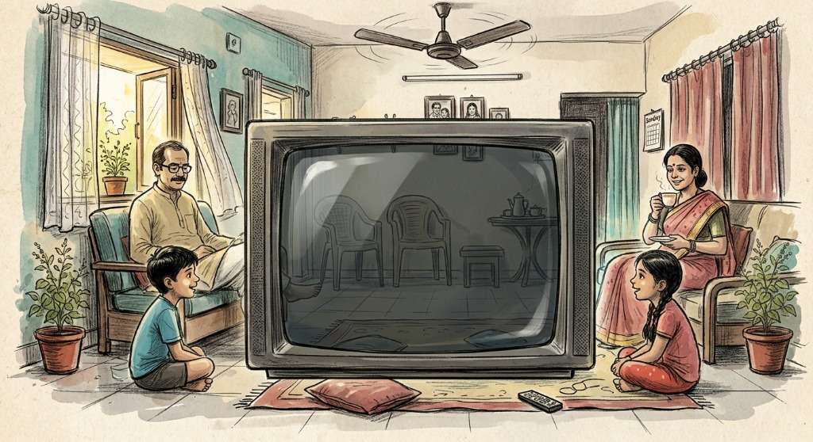

# Nostalgia TV: 90s Cartoons & Commercials Simulator 📺✨

A vibe-coded nostalgic web app that transports you back to childhood Sunday mornings in the 1990s and early 2000s. 

Featuring an illustrated vintage living room with parents drinking tea, kids sitting on the rug, and a classic CRT television playing your favorite cartoon intros, nostalgic commercial breaks, and full cartoon episodes directly from YouTube!



---

## 🌟 Highlights & Features

- **Authentic Retro CRT Television Simulation**:
  - Mounted directly onto the screen of the vintage television.
  - Realistic CRT curved glass, scanlines overlay, glossy glare reflection, and bezel vignette.
  - Authentic CRT power-on flash and phosphor sweep animation.
  - Analog TV static snow with synthesized white noise bursts when tuning or changing channels.
  - Matrix-green On-Screen Display (OSD) showing Channel (`CH 01`), Network (`CARTOON NETWORK`), volume levels, and current show title.

- **Sunday Morning TV Broadcast Simulator**:
  - **Broadcast Flow Mode**: Follows authentic TV scheduling:
    $$\text{Cartoon Intro} \longrightarrow \text{Full Episode} \longrightarrow \text{Vintage Commercial Break} \longrightarrow \text{Next Show Intro}\dots$$
  - Automatically advances to the next video as soon as the current one ends.

- **Curated 90s & 2000s Nostalgic Content**:
  - **Disney & Nickelodeon Intros**: *Drake & Josh*, *That's So Raven*, *Life with Derek*, *The Suite Life of Zack & Cody*, *The Suite Life on Deck*, *Hannah Montana*, *Phineas and Ferb*.
  - **Cartoon Network Classics**: *Ed, Edd n Eddy*, *The Powerpuff Girls*, *Dexter's Laboratory*, *Johnny Bravo*, *Swat Kats*, *Courage the Cowardly Dog*, *Spider-Man (1994)*.
  - **Hungama & Anime Classics**: *Shinchan* (Hindi Theme: "Mera Naam Bhi Shinchan Hai"), *Doraemon* (Hindi Track: "Zindagi Sawar Du"), *Pokémon*.
  - **Doordarshan Hits**: *The Jungle Book (Mowgli: Jungle Jungle Baat Chali Hai)*, *DuckTales (Hindi)*, *TaleSpin (Hindi)*.
  - **Iconic Indian Commercials**: *Center Fruit* ("Kaisi Jeebh Laplapayee"), *Tata Docomo* (Signature Tune), *Vodafone Zoozoos* (Classic IPL Ads), *Imperial Blue* ("Men Will Be Men"), *Set Wet* ("Very! Very! Sexy"), *Dhara Jalebi* ("Jalebi?!"), *Washing Powder Nirma*, *Cadbury Dairy Milk* (Cricket Match), *Hamara Bajaj*, *Action Shoes* (School Time), *Fevicol*.
  - **Cartoon Episodes**: *Shinchan (Hindi)*, *Doraemon (Hindi)*, *Tom & Jerry*, *The Jungle Book*, *Popeye the Sailor*, *Mr. Bean Animated*, *Superman (Fleischer 1941)*, *Looney Tunes (Bugs Bunny)*, *The Pink Panther*.

- **Interactive 90s Handheld Remote Control**:
  - Click on the remote lying on the carpet rug in the illustration to pick it up!
  - Features power toggle, volume/channel rockers, 1-9 direct channel number pad, TV/AV switch, mute, shuffle, and guide button.
  - Synthesized tactile click sounds using the Web Audio API (zero external sound file dependencies).

- **TV Guide & Custom URL Manager**:
  - Easily paste any YouTube URL or 11-character video ID to play it on the TV instantly or add it to your playlists.

---

## 🚀 How to Run on Localhost

Zero external packages or build steps required. Uses Python's built-in web server:

```bash
# Clone the repository
git clone https://github.com/athuphul/cartoons-nostalgia.git
cd cartoons-nostalgia

# Start the local server
./start.sh
# OR
python3 server.py 8080
```

Now open **[http://localhost:8080](http://localhost:8080)** in your browser!

*(Alternatively, you can run `python3 -m http.server 8000` or host it with any static web host like GitHub Pages, Vercel, or Netlify).*

---

## 📁 Video Configuration Files

Videos are configured in clean, user-editable files inside the `data/` directory. Both **JSON** and **plain text** formats are supported:

### 1. Cartoon Intros
- **`data/intros.json`**:
  ```json
  [
    {
      "id": "H0IQBWWabuU",
      "title": "Swat Kats: The Radical Squadron - Opening Theme",
      "url": "https://www.youtube.com/watch?v=H0IQBWWabuU",
      "show": "Swat Kats"
    }
  ]
  ```
- **`data/intros.txt`**: One URL per line with optional `# Title`:
  ```text
  https://www.youtube.com/watch?v=H0IQBWWabuU # Swat Kats
  https://www.youtube.com/watch?v=3X6WEHM-7gU # DuckTales (Hindi)
  ```

### 2. Nostalgic Commercial Ads
- **`data/ads.json`** & **`data/ads.txt`**:
  Vintage advertisements played during commercial breaks (Dhara, Nirma, Cadbury, Bajaj, etc.).

### 3. Cartoon Episodes
- **`data/episodes.json`** & **`data/episodes.txt`**:
  Full cartoon episodes and compilations.

---

## 📡 TV Channels

| Channel | Network / Name | Description |
|:---:|:---|:---|
| **01** | **Cartoon Network** | Ed, Edd n Eddy, Dexter's Lab, Powerpuff Girls, Johnny Bravo, Swat Kats |
| **02** | **Disney Channel** | Hannah Montana, Suite Life of Zack & Cody / on Deck, That's So Raven, Phineas & Ferb, Life with Derek |
| **03** | **Hungama TV** | Shinchan (Hindi), Doraemon (Hindi), Pokémon & anime favorites |
| **04** | **Nickelodeon** | Drake & Josh, classic Nick shows & cartoons |
| **05** | **Doordarshan Sunday** | Indian DD nostalgia: Mowgli Jungle Book, DuckTales Hindi, TaleSpin & classic DD ads |
| **06** | **Iconic Commercials** | Center Fruit (Laplapayi), Tata Docomo, Vodafone Zoozoos, Men Will Be Men, Set Wet, Dhara, Nirma |
| **07** | **All Intros Marathon** | Non-stop cartoon & teen show opening theme songs |
| **08** | **Full Episodes** | Shinchan, Doraemon, Tom & Jerry, Popeye, Jungle Book, Mr. Bean animated episodes |
| **09** | **Retro TV Surf** | Shuffled mix of everything |

---

## ⌨️ Keyboard Shortcuts

- **`Space`**: Play / Pause
- **`P`**: Power ON / OFF
- **`M`**: Mute / Unmute
- **`Arrow Up / Down`**: Channel Up / Down
- **`Arrow Right / Left`**: Volume Up / Down
- **`1 - 9`**: Direct Channel Tuning
- **`R`**: Toggle Handheld Remote
- **`G`**: Open TV Guide & Video Manager
